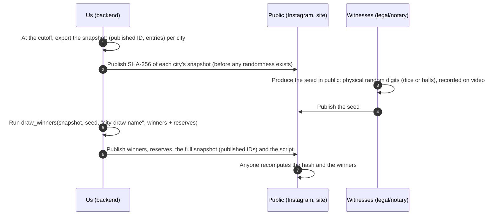

# The draw: making it impossible to call rigged

Each redeemed code is one entry in its city's draw (Tokyo codes → Tokyo trip, and so on).
Gamers will assume the draw is rigged unless they can check it themselves. This procedure
lets anyone re-run the draw and get the same winners. It is Phase 3 work, but the algorithm
already exists and is tested (`app/domain/draw.py`, `tests/unit/test_draw.py`), so legal can
review it now.

**Legal first**: whether a purchase-linked draw is allowed, and under which supervision, is
decided by counsel (L01 in [TODO.md](TODO.md#legal-counsel)). The steps below fit inside
whatever supervision they require (notary, authority representative), they do not replace it.

## Contents

- [Rules to fix before announcing a draw](#rules-to-fix-before-announcing-a-draw)
- [Procedure](#procedure)
- [The algorithm](#the-algorithm)
- [After the draw](#after-the-draw)

## Rules to fix before announcing a draw

Written in the T&Cs, approved by legal, published before entries start counting for that draw:

| Rule | Recommendation |
|---|---|
| Which entries count | Codes redeemed from batch activation until the cutoff, by accounts in good standing |
| Cutoff | A Tehran wall-clock time, for example 23:59:59 on 30 Aban 1405, announced in advance |
| Prizes per draw | Number of winners and number of reserves (for example 1 winner + 5 reserves) |
| One prize per person | Per draw, and per season across draws if marketing wants wider spread |
| Eligibility | Minimum age, residency, no employees or lounge staff and their families, identity verified at claim |
| Unclaimable prizes | Deadline to respond (for example 7 days); after that the next reserve |
| Travel conditions | Passport validity, visa refusal, conscription-age travel permits, guardian for minors, cash or alternative prize if travel is impossible ([GOTCHAS.md](GOTCHAS.md#legal-and-prizes)) |

## Procedure

1. **Snapshot at the cutoff.** Export, per city, every participant with at least one entry: a **published ID** (not the phone number; for example the first 10 characters of `HMAC(draw secret, user id)`, so players can find themselves but not each other) and their entry count. Freeze the file.
2. **Publish the hash first.** Post the SHA-256 (`snapshot_digest`) of each city's snapshot before the seed exists. After this, we can no longer change the entries without everyone noticing.
3. **Make the seed in public.** For example 20 rolls of a ten-sided die (or numbered balls) in front of the witnesses, filmed, written down as a string of digits. The seed is the UTF-8 bytes of that string. Nobody, including us, can know it in advance.
4. **Run the draw.** `draw_winners(snapshot, seed, label, winners + reserves)` with a label naming the draw (`tokyo-1405-aban`). The first entries of the result are winners, the rest reserves, in order.
5. **Publish everything**: the snapshot files, the seed, the label, the result, and a link to `app/domain/draw.py`. A player who doubts it can run 30 lines of Python.
6. **Rehearse** the whole procedure on staging one week before, with the witnesses if possible.

## The algorithm

- Participants are sorted by published ID (so the order of the file does not matter).
- For each round, a number `ticket` in `[0, total entries)` is derived from `HMAC-SHA256(seed, "label:round:counter")`, with rejection sampling so every value is equally likely.
- Walking the sorted list and adding up entries, the participant whose range contains `ticket` wins; they are removed and the next round starts.
- So a player with 6 entries out of 10 has a 60% chance in round 1 (checked statistically in the tests).

## After the draw

- Verify each winner (identity matches the mobile number's owner, age, no fraud flags from the daily checks, consent to publicity). If verification fails or the deadline passes, move to the next reserve and publish that.
- Keep the snapshot, video, seed and verification records for as long as legal requires.
- Never "re-draw because the result looks bad". The only valid reasons to skip a winner are the published rules.
