# Game design

What the game is, why it should work for competitive Gen Z gamers, the coin economy, the
challenge catalog marketing can use, what to measure, and a short learning path for you.

## Contents

- [Who we design for](#who-we-design-for)
- [The loops](#the-loops)
- [Principles for this audience](#principles-for-this-audience)
- [Default economy](#default-economy)
- [Challenge catalog](#challenge-catalog)
- [First 14 days of content (template)](#first-14-days-of-content-template)
- [Anti-patterns](#anti-patterns)
- [What to measure](#what-to-measure)
- [Learning path (about 8 hours)](#learning-path-about-8-hours)

## Who we design for

Regulars of three big gaming lounges: competitive PC and console players (Dota 2, League of
Legends, Overwatch, FC/FIFA and whatever the lounge's current favourites are), roughly 15 to 30,
mostly Gen Z and Alpha. They:

- recognise manipulation instantly and mock it in group chats;
- care about **status among people they actually know** (their lounge, their squad), not about badges from a brand;
- understand ranked ladders, seasons, battle passes and patch notes better than any marketer;
- will find and share any exploit within days, especially with a trip abroad at stake.

You know this crowd from ten years in these places. That knowledge is the most valuable input
in this document: when a rule here contradicts what you see at the lounge, the lounge wins.

## The loops

```mermaid
flowchart LR
    subgraph core["Core loop (every drink, ~10 seconds)"]
        buy["Buy a city drink"] --> scan["Open, scan the QR"]
        scan --> reward["+1 city entry<br/>+coins<br/>challenge progress"]
        reward --> look["Passport stamp,<br/>rank moves"]
    end
    subgraph daily["Daily loop"]
        check["Today's challenges"] --> play["Play at the lounge"]
        play --> claim["Claim rewards"]
        claim --> glance["Glance at the lounge leaderboard"]
    end
    subgraph weekly["Weekly loop (resets Saturday 00:00)"]
        reset["New weekly board<br/>and challenges"] --> tourney["Tournament night"]
        tourney --> winners["Winners on the lounge screen<br/>and Instagram"]
    end
    look --> check
    glance --> reset
```

The **season loop** (Phase 4) wraps these: complete the 7-city passport, the city draws happen,
the season resets with new challenges and a new board.

## Principles for this audience

1. **Honest and transparent.** Publish the rules, the odds ("your Tokyo entries: 7 of 4,312"), and the draw procedure ([DRAW.md](DRAW.md)). No fake countdowns, no "only 2 left!", no hidden conditions.
2. **Status they can feel.** Their gamer tag on the lounge TV leaderboard and in tournament results beats any digital badge. Weekly resets give everyone a fresh chance.
3. **Skill and presence beat spending.** Coins also come from challenges, tournaments and social posts; coins from codes are capped per day (20 codes x 10 coins), so nobody buys the leaderboard with a crate of drinks. Entries in the trip draw stay purchase-based (that is the sales mechanic), but the leaderboard and status are not.
4. **Collection.** Seven cities, seven stamps: completing the passport is a natural goal and a reason to try other SKUs. A completion bonus is a cheap, strong motivator (Phase 2).
5. **Lounge identity.** Lounge vs lounge rivalry (weekly totals per lounge) and later squads turn individuals into teams. Staff-run challenges ("beat the staff at FC") create stories.
6. **Zero friction.** QR to result in under 10 seconds; the SMS code fills itself; one tap to claim. Every extra screen loses players.
7. **Gamer tone, written by gamers.** Short, Persian, self-aware. Have two lounge regulars review the copy before launch; if they cringe, rewrite it.
8. **No gambling mechanics beyond the regulated draw.** No loot boxes or paid random rewards; many players are minors, and it is a legal risk.

## Default economy

Used if Mehdi has not decided by D4 (decision Q4/Q6). Coins have no cash value; their cost to
the company appears only when the prize store opens (Phase 2), so these numbers can be tuned
before then.

| Source | Coins | Limit |
|---|---|---|
| Redeem a code | 10 | 20 codes per day per person |
| Complete profile (once) | 10 | once |
| Daily challenge | 10–20 | per challenge per day |
| Weekly challenge | 50–100 | per challenge per week |
| Social post approved | 30–50 | one per social challenge per week |
| Tournament prize | 1st 300, 2nd 150, 3rd 75 | per tournament |
| Passport complete (all 7 cities) | 100 (Phase 2) | once per season |

**Budget check before the store opens**: total coins issued per week = (codes redeemed x 10) +
challenge payouts + tournament prizes. Query it from the ledger
(`SELECT date_trunc('week', created_at), sum(amount) FROM coin_ledger_entries WHERE amount > 0 GROUP BY 1`).
Price store items so that, if every coin issued were spent, the cost stays inside the prize
budget; scarcity (limited stock per week) does the rest.

## Challenge catalog

Only these types exist in the MVP (B17, B18). Anything else is a Phase 2 request.

| Type | How it is verified | Example (write the Persian copy with a gamer's voice) |
|---|---|---|
| `redeem_count` (day or week) | Automatically, from redemptions | "Double tap: redeem 2 codes today" (15 coins) |
| `distinct_cities` (day or week) | Automatically | "World tour: 3 different cities this week" (60) |
| `social_post` (week) | Marketing approves the Instagram URL | "Post your passport stamp with #<hashtag> and tag <account>" (50) |
| `manual` (day, week or once) | Lounge staff or marketing confirms in admin | "Beat a staff member at FC tonight", "Join the Dota 2 5v5 at 21:00", "MVP of tonight's Overwatch scrim" (40) |
| `once` | Automatically | "Complete your profile and pick your lounge" (10) |

Rules of thumb: at most 3 daily challenges at a time; at least one weekly challenge that does
**not** require buying anything; a new twist every week so the list never feels like a chore.

## First 14 days of content (template)

| Day | Daily (rotate) | Weekly (Saturday to Friday) | Event |
|---|---|---|---|
| Launch week | Redeem 1 code (10); Redeem 2 codes (15) | Collect 3 cities (60); Social post (50) | Opening tournament at each lounge (FC) |
| Week 2 | Redeem 1 code (10); staff challenge of the day (20) | Collect 4 cities (80); Social post (50); Play in a tournament (40) | Dota 2 or LoL 5v5 night; lounge vs lounge weekly total |

Mehdi fills in the exact Persian titles, hashtags and dates (M06) and loads them in the admin panel.

## Anti-patterns

| Do not | Why |
|---|---|
| Punishing streaks ("you lost your 12-day streak!") | Anxiety and resentment; if streaks come later, allow catch-up days |
| Ranking by balance | Spending lowers your rank, so nobody spends; rank by coins earned this week |
| Fake scarcity or fake urgency | This audience screenshots it and mocks it |
| Ten badges for nothing | Badges only mean something if they are hard and visible to peers |
| Two confusing currencies | Exactly two concepts: **entries** (trip chances, per city) and **coins** (spend later). Explain both on one screen |
| Gating features behind "follow us on Instagram" | Feels like a trap; make social posts optional bonus challenges |
| Marketing SMS without opt-in | Unwanted promotional SMS is restricted; it also burns trust |
| Corporate copy | Kills the vibe in one sentence; let gamers write or review it |

## What to measure

Agree these with the CEO (M13) so success is not judged on vibes:

| Question | Metric | From |
|---|---|---|
| Do scans turn into players? | Share of QR landings that finish sign-in and redeem | nginx `/r/` hits vs first redemptions |
| Do they come back? | Players redeeming in week 2 who also redeemed in week 1 | `redemption_codes` |
| Does it move product? | Redemptions per city per week; players with 2+ cities | `redemption_codes`; sales data from Mehdi per SKU per lounge vs the weeks before launch |
| Is the game engaging beyond buying? | Challenge claims per active player; tournament entries; social submissions and approval rate | ledger, submissions |
| Is it fair? | Top 20 accounts reviewed weekly; fraud flags found | daily checks |
| Does each lounge benefit? | Active players and redemptions per lounge | home lounge, lounge IPs |

## Learning path (about 8 hours)

Short and practical, in this order. Do the first three before D8; the rest after launch.

| # | Resource | Time | Why |
|---|---|---|---|
| 1 | Ian Bogost, "Gamification is bullshit" (essay, 2011) | 15 min | The skeptic's view: exactly how your audience will judge a brand game |
| 2 | Self-Determination Theory, any short primer (autonomy, competence, relatedness) | 20 min | The motivation model behind every principle above |
| 3 | Yu-kai Chou, the **Octalysis** framework overview (yukaichou.com) | 1 h | A checklist of 8 motivation drives; use it to review each challenge |
| 4 | Andrzej Marczewski, **HEXAD** player types (gamified.uk) | 30 min | Design for achievers, socialisers, free spirits, and the players who will try to break the system |
| 5 | Kevin Werbach, **"Gamification"** (University of Pennsylvania, on Coursera; free to audit) | 4–5 h | Weeks 1–4 at 1.5x speed: the course most people in the field started with |
| 6 | Celia Hodent, **"The Gamer's Brain"** (book) | after launch | Game UX and psychology from someone who worked on Fortnite |
| 7 | Werbach & Hunter, **"For the Win"** (book, revised 2020) | optional | The course in book form |

Availability of online courses can change and some platforms restrict access from Iran;
check before you plan around them.
